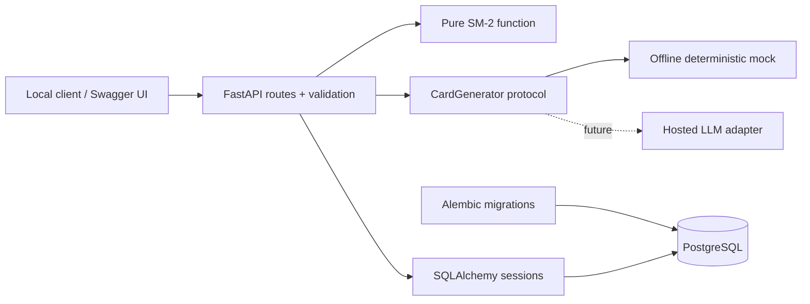

# TechCards SRS MVP

## Problem and niche
IT candidates preparing for remote US roles need to practice the technical English
in real vacancies and interviews. Generic flashcards require manual selection and
do not connect vocabulary with interview practice. This API turns pasted job
descriptions, articles or interview material into reusable study cards.
There are no measured adoption, retention or business outcomes yet.

## Users
Junior cloud/support engineers, Python backend candidates and data practitioners.
The local MVP has one trusted operator; accounts and multi-user isolation are deferred.

## Scope
In: deck/card CRUD, SM-2 reviews, due cards, persisted review events, bounded pasted
text input, deterministic offline generation behind a provider interface, migrations,
Docker, automated tests and CI.
Out: frontend, authentication, FSRS, audio, scraping, hosted LLM calls, AWS resources,
Terraform, deployment pipelines and retention dashboards. Do not expose this unauthenticated
API publicly. The public repository is a portfolio artifact, not a deployed service.

## Data model
- `decks`: id, name, description.
- `cards`: id, deck_id, front, back, kind (vocabulary/interview_phrase/behavioral),
  repetitions, interval_days, ease_factor and due_date. Indexed by deck and due date.
- `reviews`: id, card_id, quality, reviewed_at and resulting scheduling fields.
  Each event and its card update commit in one transaction. PostgreSQL row locks
  serialize reviews of the same card.
- Foreign keys cascade deck → cards → reviews on deletion. There is no user table yet.

## SM-2
The pure function accepts prior state, quality (integer 0–5) and review date.
Starting ease is 2.5. Successful grades (3–5) schedule intervals of 1 day, 6 days,
then the previous interval multiplied by the previous ease, rounded upward.
Grades below 3 reset successful repetitions to zero and schedule 1 day.
Ease changes by `0.1 - (5-q)*(0.08 + (5-q)*0.02)`, with a floor of 1.3.
The API schedules from the server's UTC date; new cards are due immediately.
Early reviews are accepted, and repeated POSTs are separate reviews (no idempotency key).
The original SM-2 also describes same-session relearning: that UI loop is outside this
API; failed cards become due tomorrow.
Reference: [original SM-2 algorithm](https://super-memory.org/english/ol/sm2.htm).

## Review transactions and retry semantics
- **Atomic card + history updates:** `POST /reviews` locks the target `cards` row with
  `SELECT ... FOR UPDATE`, computes the next SM-2 schedule from that committed state,
  updates `cards`, inserts the matching `reviews` row, flushes and validates the response
  inside the same transaction, and commits both writes together. Any scheduling or
  database error rolls back the entire transaction so neither `cards` nor `reviews`
  commits partial state.
- **Concurrency:** PostgreSQL row locks serialize overlapping `POST /reviews` requests
  for the same card so each subsequent review reads the committed state of the previous
  one (or the unmodified state if the previous transaction rolled back). SQLite is used
  only for sequential unit tests and does not provide PostgreSQL row locking.
- **UTC boundaries and submission timing:** Card creation (`due_date`), due queries
  (`due_date <= today(UTC)`), and review scheduling all use the server's UTC date.
  Reviews at `23:59:59Z` schedule from that UTC day; reviews at `00:00:00Z` schedule from
  the next UTC day, when cards due on that date enter the due queue immediately. Early
  and overdue submissions are both accepted and scheduled from the current UTC review date.
- **Intentional non-idempotent retries:** `POST /reviews` is **not idempotent** and has
  no idempotency key or request deduplication. Every accepted request appends a new
  `reviews` row and advances or resets the card schedule again.
  - `404` and `422` errors never mutate state.
  - `5xx` errors or dropped connections / timeouts have an ambiguous outcome (the
    transaction may have rolled back or committed before the connection dropped). Do not
    blindly auto-retry `POST /reviews`; inspect `GET /cards/{id}` before deciding whether
    to submit again. Idempotency keys are deferred until a client requires safe auto-retry.

## API
Interactive schemas and examples are available at `/docs` and `/openapi.json`.

| Method | Path | Behavior |
| --- | --- | --- |
| GET | /health | Process liveness (not database readiness) |
| POST / GET | /decks | Create / list decks |
| GET / PUT / DELETE | /decks/{id} | Read / replace editable fields / delete |
| POST / GET | /cards | Create / list (optional deck_id filter) |
| GET / PUT / DELETE | /cards/{id} | Read / replace editable fields / delete |
| GET | /decks/{id}/due | Cards due on or before UTC today |
| POST | /reviews | Record quality and update schedule atomically |
| POST | /cards/generate | Persist cards from pasted text in a selected deck |

Lists accept `offset` (default 0) and `limit` (1–100, default 100).
Missing resources return 404; invalid input returns 422; creation returns 201;
deletion returns 204. PUT preserves scheduling state. Review history is stored
for later analysis; a history read endpoint is deferred.
Generation accepts `deck_id`, `text` (10–20,000 characters), `max_cards` (1–20).
It returns **up to** the requested count. The mock recognizes a small fixed glossary
and adds interview templates; unfamiliar text receives generic practice prompts.
It is deterministic, does not summarize arbitrary text, and makes no network calls.
Pasted source text is not stored, though matched topics appear in cards.

## Architecture

## Roadmap

The [personal English learning plan](PROJECT_PLAN.md) extends this implemented MVP
with Angel's interview-focused learning loop and Saturday milestones through May 2027.
The scope above describes what is implemented today.

1. Local MVP: the API, mock strategy, PostgreSQL, migrations, tests and CI in this repo.
2. AI generation: add an adapter, structured output validation, timeout/error policy,
   explicit opt-in configuration and an evaluation set; never silently transmit pasted text.
3. AWS: choose ECS or Lambda; provision RDS, S3 audio storage, Polly and CloudWatch
   using Terraform, with GitHub Actions deployment via OIDC. Design IAM, secrets,
   budgets, backups and authentication before public exposure. Not implemented here.
4. Stats/data: define review event semantics and retention/cohort queries, then evaluate
   results using collected data. FSRS is a later experiment, not part of this MVP.

## Skills and target roles
| Demonstrated skill | Role requirement | Evidence / boundary |
| --- | --- | --- |
| Containers, health endpoint, environment config | Cloud Support / junior AWS Cloud Engineer | Local Compose and Dockerfile; AWS is future work |
| Troubleshooting and repeatable checks | Cloud Support | README runbook, tests and CI logs |
| FastAPI, validation, strategy interface | Python backend | Routes, schemas and injectable generator |
| SQLAlchemy, PostgreSQL, Alembic, transactions | Python backend | Relational schema, migrations and atomic reviews |
| Pure scheduling logic and automated checks | Python backend | SM-2 unit tests, API integration tests |
| Review events and relational queries | Data | Persisted review outcomes; analytics are deferred |
| Infrastructure as code, IAM, observability | Junior AWS Cloud Engineer | Documented roadmap only; no claim of implementation |
